# Charts

Behavior charts for the [`adaptive-rate-limiter`](../adaptive-rate-limiter), the
[`admission-controller`](../admission-controller), the [`rate-limiter`](../rate-limiter), and the
[`circuit-breaker`](../circuit-breaker). This module drives each component through a set of scripted scenarios,
exports the resulting timeseries as CSV, and renders them to PNG with matplotlib. The images are what you see embedded
in the project documentation.

This is a documentation/tooling module only — it is not published (`publish / skip := true`).

## Pipeline

Generating charts is a staged pipeline: Scala simulates and writes CSVs, Python renders them, and nothing lands in
`docs/` until you have compared the result and promoted it.

```bash
python3 -m venv .venv && .venv/bin/pip install -r charts/scripts/requirements.txt  # once

sbt "charts/run [component ...]"                                   # 1. simulate: CSVs into the staging dir
.venv/bin/python charts/scripts/charts.py render [component ...]   # 2. render: PNGs into the staging dir
.venv/bin/python charts/scripts/charts.py compare [component ...]  # 3. review: what changed vs docs/
.venv/bin/python charts/scripts/charts.py promote [component ...]  # 4. publish: mirror staging into docs/
```

The components are `adaptive-rate-limiter`, `admission-controller`, `rate-limiter`, and `circuit-breaker`; every
command defaults to all of them (or, after the first step, to all of those with staged data).

The staging dir, `charts/target/staging/`, mirrors the layout of `docs/` (and like any `target/` it is ignored by git
and wiped by `sbt clean`):

| | staged | promoted |
|---|---|---|
| data | `charts/target/staging/charts/<component>/` | `docs/charts/<component>/` |
| images | `charts/target/staging/images/<component>/` | `docs/images/<component>/` |

- **Simulate.** [`GenerateCharts`](src/main/scala/io/mienks/resilience/charts/GenerateCharts.scala) runs the
  components one after another, and each component's scenarios in parallel. Per component it writes
  `<scenario>-samples.csv` (the sampled timeseries), `<scenario>-events.csv` (discrete events such as rate changes or
  breaker transitions, only for scenarios that have any), and `manifest.csv` (the index the renderer reads).
- **Render.** `render` turns every scenario in a staged manifest into a PNG, using the component's renderer in
  [`renderers/`](scripts/renderers). Adding a scenario on the Scala side needs no change to the Python. To re-render
  the data already in `docs/` (to review a renderer change on its own, without simulation noise), use
  `render --from-docs`.
- **Compare.** `compare` prints which images and CSVs were changed, added, or removed relative to `docs/` (images are
  compared by pixels) and writes `charts/target/staging/compare.html`, which shows the current and staged image of
  every differing scenario side by side.
- **Promote.** `promote` makes the component's CSVs and PNGs in `docs/` an exact copy of the staged ones, deleting
  any scenario that no longer exists. It refuses if a staged image is missing or older than its data.

The simulations run in real time on a thread pool, so two runs never produce identical timeseries: expect a promoted
chart to differ slightly from the one before it even when nothing changed. Before recording, each component's
scenarios run for a few seconds and are discarded, to warm up the JIT, whose compilation stalls would otherwise show
up in the timeseries as gaps.

### Code layout

Each component has its own package under
[`io.mienks.resilience.charts`](src/main/scala/io/mienks/resilience/charts) with a `Scenario.scala` (the scripted
scenarios) and a `Simulation.scala` (wires the component to its load and backend, and samples it). The shared pieces
live in the root package:

- `Component` / `Chart` / `Recording` — what a simulation exposes to `GenerateCharts`.
- `Timeline` — samples a simulation on a fixed period and records its discrete events.
- `Meter` — counts calls and reports their rate since the previous sample.
- `Load.openLoop` — offers calls at a scripted rate regardless of how fast they complete.
- `Backend` — the capacity-limited backend described below.
- `CsvTable` — writes the CSVs.

## How the simulated backend works

The whole point of the adaptive rate limiter is to *discover* the rate a downstream resource can sustain. To exercise
that, we need a backend whose failure rate depends on how hard we hit it — otherwise the control loop has nothing to
react to. That backend is modeled in [`Backend.scala`](src/main/scala/io/mienks/resilience/charts/Backend.scala), and
is shared by the adaptive rate limiter and admission controller charts.

A backend phase is a **hard ceiling** plus zero or more **soft ceilings**, each a token bucket (the project's own
[`DynamicRateLimiter`](../rate-limiter)):

- The **hard ceiling** is the base, sustainable rate. Any call admitted *above* it fails outright (100%).
- Each **soft ceiling** (`SoftCeiling(capacity, failProbability)`, with `failProbability < 1.0`) is a tighter rate
  that fails only a *fraction* of the calls that overflow it.
- Every call consumes one token from the hard bucket and every soft bucket, and fails with the **most severe**
  `failProbability` among the ceilings it overflowed (the hard ceiling contributing `1.0`).

So the observed failure ratio is an emergent property of the rate the limiter admits — overflow a ceiling and failures
appear, back off and they clear. This is what closes the loop:

```
AIMD rate estimate ──admits requests──▶ Backend (hard + soft ceilings)
        ▲                                      │
        └────────── failure ratio ◀────────────┘
```

Two backend shapes are used:

- **Hard ceiling only** (`softCeilings = Nil`): one bucket at the base capacity whose overflow always fails. The
  failure ratio is essentially `1 - capacity/admitted`.
- **Graded** (a soft ceiling under the hard one): e.g. over `80.perSecond` fail 100%, but already over the smaller
  `40.perSecond` fail 50%. This produces two distinct failure levels and trips both hysteresis bands.

A scenario's `NonEmptyList[Backend.Phase]` is the backend's capacity over time. A hard ceiling *below* the limiter's
`maxRate` is a degraded backend; raising it again is recovery. The whole schedule is handed to `Backend.start` up
front, and an internal fiber walks it, reconfiguring the ceilings as each phase begins.

The circuit breaker charts use a different backend,
[`FlakyBackend`](src/main/scala/io/mienks/resilience/charts/circuitbreaker/FlakyBackend.scala), whose error rate is
scripted directly rather than emerging from load: a breaker reacts to failures, not to throughput. The rate limiter
charts need no backend at all.

## Adaptive rate limiter

The [scenarios](src/main/scala/io/mienks/resilience/charts/adaptiveratelimiter/Scenario.scala) drive the limiter in a
closed loop against the backend above: a few clients call through `limiter.protect`, and the limiter's rate and
failure ratio are sampled on a fixed cadence alongside its `onRateChange` and `onFailureCategoryChange` events.

> Note: rates are kept in the hundreds of rps even though the time scale is compressed to a few seconds. The closed
> loop derives the failure ratio from requests the limiter *actually admits*, so each measurement window needs enough
> admitted requests for the ratio to be meaningful.

Each chart plots, on the left axis, the **AIMD rate estimate** (controlled variable), the **admitted** throughput
(measured), and the **backend capacity** (the bottleneck being discovered, dashed); on the right axis the limiter's
**observed failure ratio**. Vertical lines mark `worsening` / `recovering` / `recovered` control-loop events.

### congestion-sawtooth
Constant backend capacity below `maxRate`: AIMD oscillates around it in the classic TCP sawtooth — additive increase
ramps the rate up until failures appear, a multiplicative decrease cuts it, and the cycle repeats.

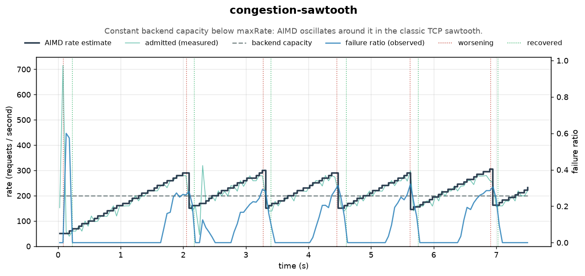

### quick-degradation
A sudden capacity drop trips a band and cuts the rate into a lower sawtooth around the new, reduced capacity.

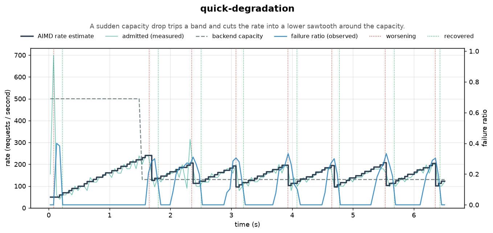

### degrade-then-recover
After a capacity collapse and rate cut, restored capacity returns the backend to healthy and the rate climbs back to
`maxRate`.

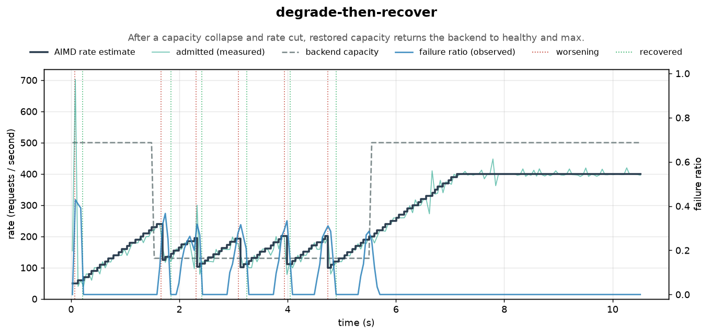

### slow-recovery
Capacity recovers in steps; the limiter climbs back to a higher safe rate at each step.

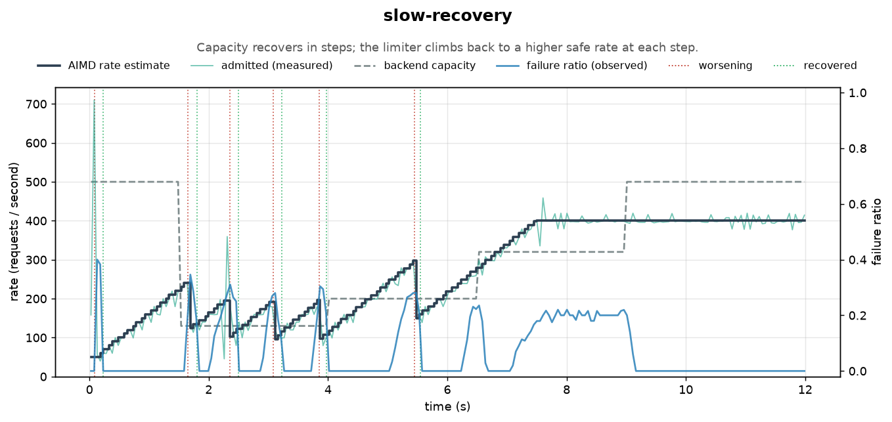

### flapping
Capacity flaps between healthy and degraded: compounding cuts ratchet the rate toward the floor.

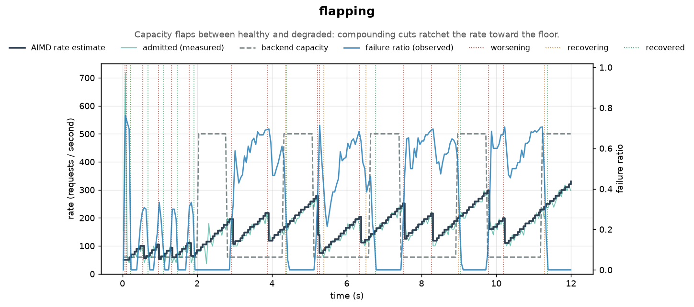

### slow-degradation
Capacity steps down gradually; the limiter re-discovers a lower safe rate at each step.

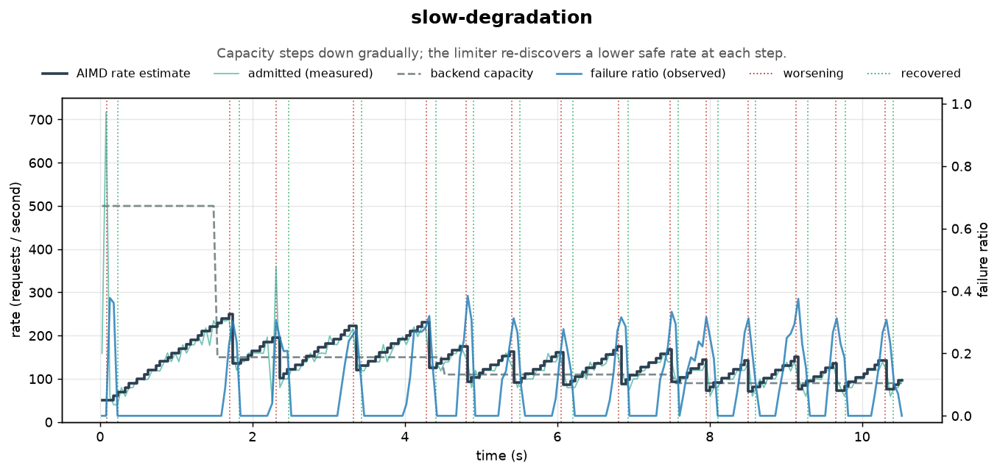

### graded-degradation
A two-tier backend (soft + hard ceiling) produces two distinct failure levels across the hysteresis bands.

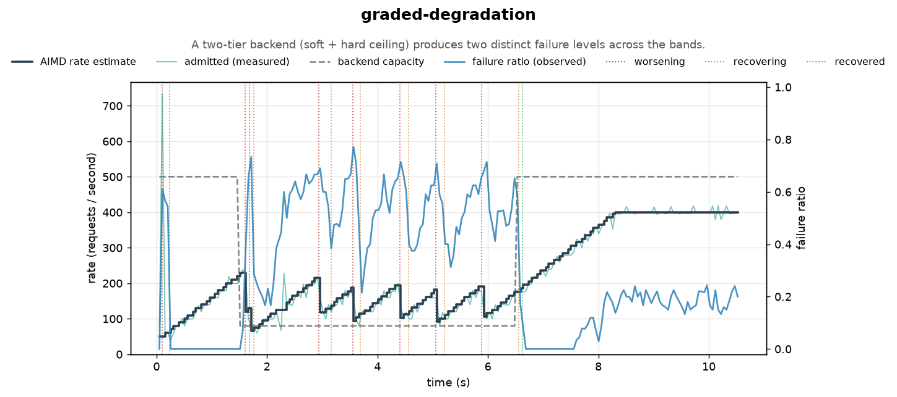

## Admission controller

The admission controller charts tell a different story than the rate limiter. Instead of discovering and tracking a
*rate*, the controller probabilistically sheds load so the backend's accepted goodput stays near its capacity. Under
overload it keeps the admitted load near `k * capacity` (with the SRE default `k = 2.0`), holding a smooth plateau
rather than the AIMD sawtooth, and on recovery the rejection probability returns to zero because `k > 1` guarantees the
gate fully reopens.

The same simulated backend is reused: any call admitted *above* the hard ceiling is "throttled" (a failure), which is
exactly the downstream-overload signal the controller sheds against. Each
[scenario](src/main/scala/io/mienks/resilience/charts/admissioncontroller/Scenario.scala) holds the offered load
constant and well above the degraded capacities, then schedules capacity over time via `Backend.Phase`. There is no
events file — the controller has no discrete state transitions to mark.

Each chart plots, on the left axis, the **client input rate** (load before the gate), the **client allowed rate**
(what the controller admits), the **backend actual rate** (goodput, allowed minus throttled), and the **backend
capacity** (dashed); on the right axis the controller's **failure ratio** (dotted, unclamped) and **rejection
probability** in `[0, 1]`. The failure ratio keeps rising with throttling while the rejection probability stays pinned
at zero inside the dead zone — the gap between the two lines is the dead zone.

### steady-overload
Constant capacity below offered load: the controller sheds the excess, holding admitted near `k*capacity` and goodput
near capacity — a smooth plateau, no sawtooth.

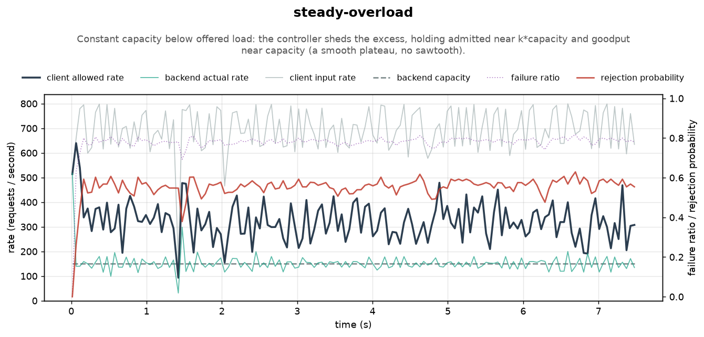

### capacity-drop
A sudden capacity drop pushes the rejection probability from zero up to a steady shedding level.

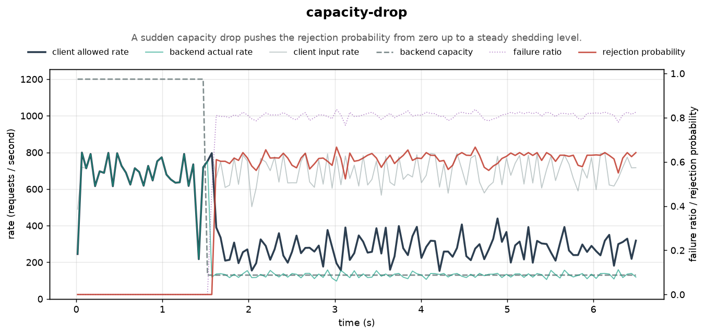

### drop-then-recover
After a capacity collapse and shedding, restored capacity drives the rejection probability back to zero (`k > 1`
guarantees the gate fully reopens).

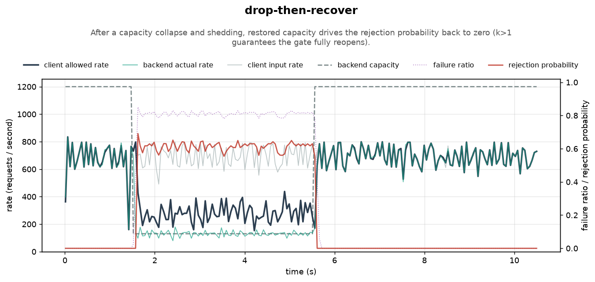

### slow-degradation
Capacity steps through four overload levels. The two milder levels keep the failure rate inside `k = 2`'s 50% dead
zone, so the controller tolerates the throttling (you can see the backend throttling — the gap to capacity — but the
rejection probability stays at zero and nothing is shed); the two harsher levels cross the dead zone and the rejection
probability steps up.

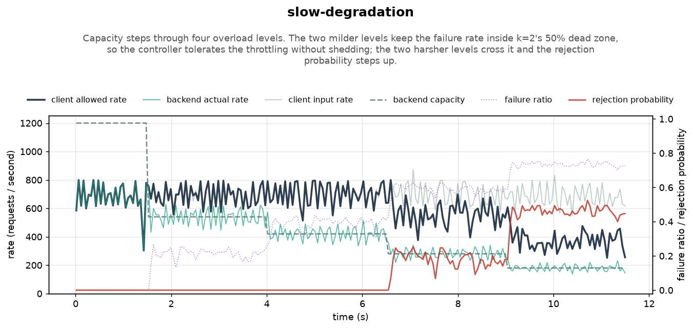

### Comparing `k`

The `k` parameter sets how aggressively the controller sheds. These runs hold the same capacity profile fixed and vary
only `k`, so the effect is isolated. The admitted plateau lands around `k * capacity`: higher `k` admits more (and
tolerates more backend-side throttling) while lower `k` sheds harder. Compare against the default `k = 2.0`
[steady-overload](#steady-overload) and [drop-then-recover](#drop-then-recover) above.

#### steady-overload-k1
`k = 1` is the plain failure ratio. Admitted collapses to around capacity with no wasted backend work, but the loop is
only marginally stable: the rate is jittery and often dips below capacity, under-utilizing the backend.

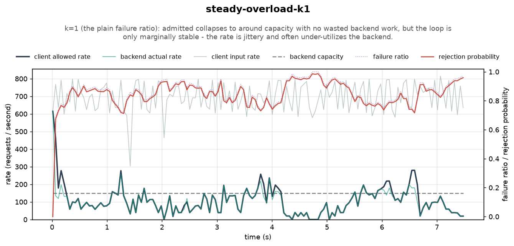

#### steady-overload-k1.5
`k = 1.5` is the middle ground: the admitted plateau settles around `1.5 * capacity`, between the `k = 1` and `k = 2`
cases, while goodput stays near capacity.

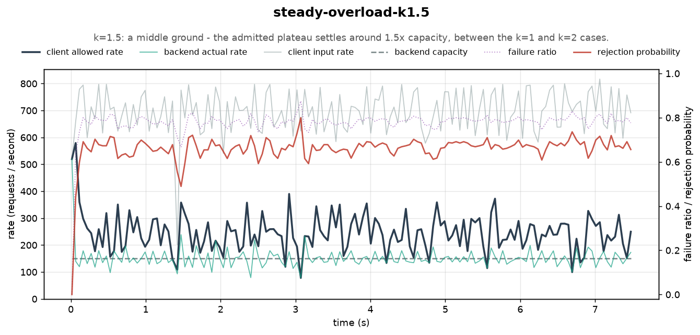

#### drop-then-recover-k1.5
`k = 1.5` over the recovery profile: a lower admitted plateau than `k = 2` while overloaded, and the gate still fully
reopens once capacity is restored.

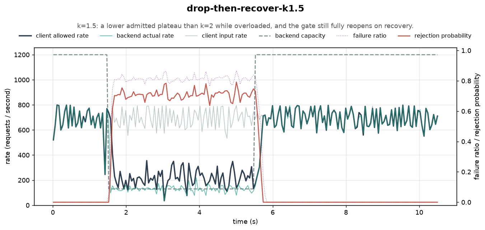

#### drop-then-recover-k1
`k = 1` over the recovery profile lays bare the marginal stability: after capacity is restored the rejection
probability lingers high and only drifts back to zero slowly, instead of snapping back the way `k = 2` does. This is the
concrete reason the default is `k > 1`.

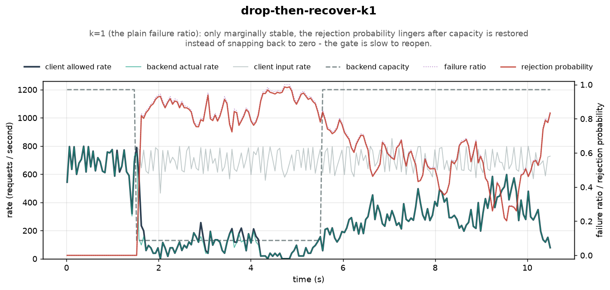

#### slow-degradation-k1.5
The same four-level staircase as [slow-degradation](#slow-degradation), but at `k = 1.5` the dead zone shrinks from a
50% failure rate to ~33%. The second (milder) level — tolerated with no shedding at `k = 2` — now crosses the dead zone,
so the controller begins shedding one step earlier. A direct, visual read of how `k` sets the tolerance threshold.

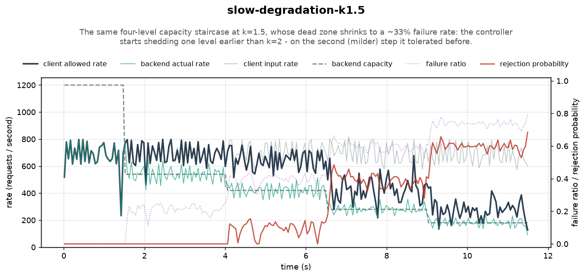

## Rate limiter

The rate limiter charts are open loop: a client offers calls at a scripted rate through a `DynamicRateLimiter`, which
admits a call only if it can take a token. Each
[scenario](src/main/scala/io/mienks/resilience/charts/ratelimiter/Scenario.scala) is a list of load phases, and a
phase may also reconfigure the limiter with `setRefillRate` or `setCapacity` as it begins.

Each chart plots, on the left axis, the **offered** and **admitted** rates and the limiter's **refill rate** (dashed);
on the right axis the **available tokens** and the **bucket capacity** (dashed). The refill rate bounds the long-run
admitted rate, while the bucket's stored tokens decide how much of a burst gets through above it.

### burst-then-throttle
A full bucket lets the start of a burst through at the offered rate, then admission flattens to the refill rate. Idle
time refills the bucket, capped at its capacity.

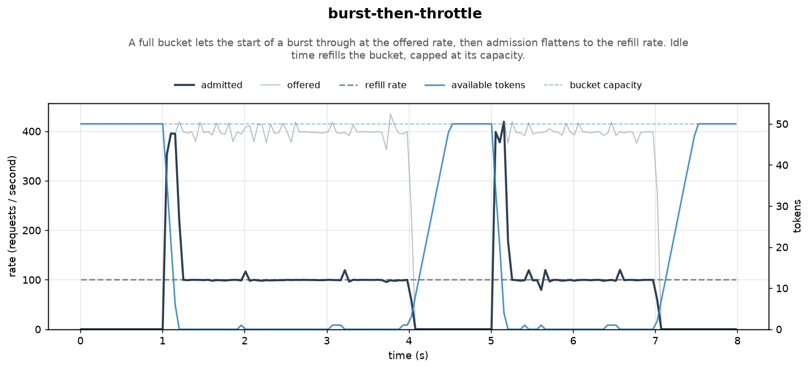

### load-staircase
Offered load steps from below to above the refill rate. Below it every call is admitted and the bucket stays full;
above it the bucket drains and admission caps at the refill rate.

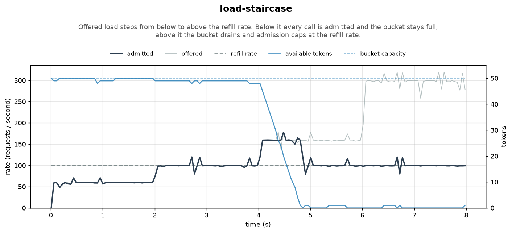

### bursty-load-small-bucket
Bursts of 100 calls (500 rps for 200ms every second, so the average load equals the refill rate) against a 10-token
bucket: only the stored tokens plus what refills during the burst get through, so most of each burst is rejected.

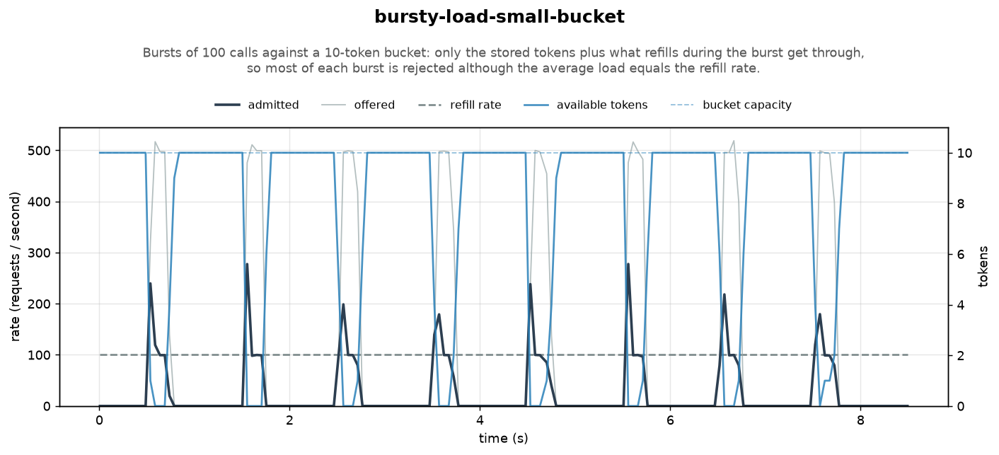

### bursty-load-large-bucket
The same bursts against a 100-token bucket: the idle time between bursts refills it, so every burst is absorbed in
full while the long-run admitted rate still matches the refill rate.

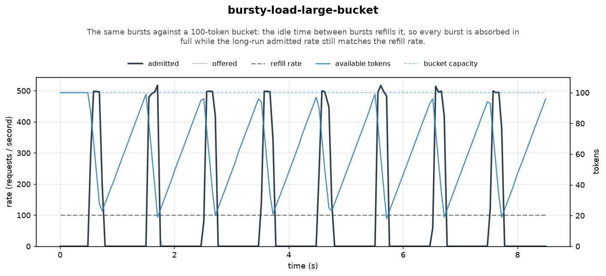

### dynamic-refill-rate
`setRefillRate` changes the rate under a steady 200 rps load: admission follows the lower of the offered and refill
rates, and the bucket's stored tokens carry across each change.

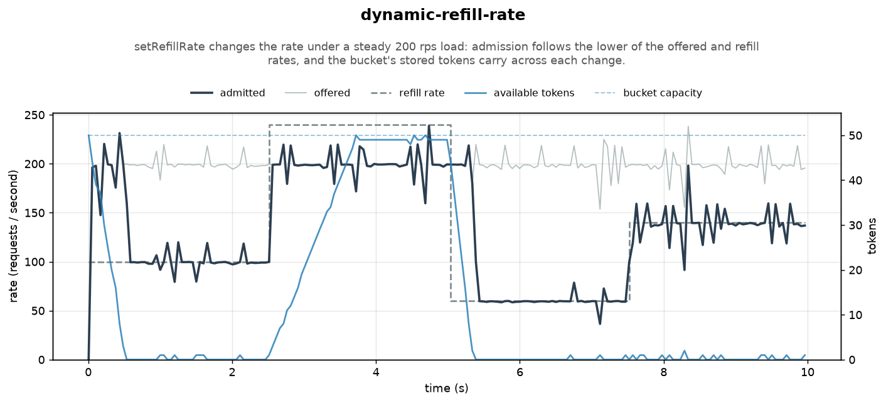

### dynamic-capacity
`setCapacity` resizes the bucket between bursts: shrinking clamps the stored tokens at once, while growing lets them
refill gradually at the refill rate (no phantom tokens), and each burst gets through in proportion to the bucket.

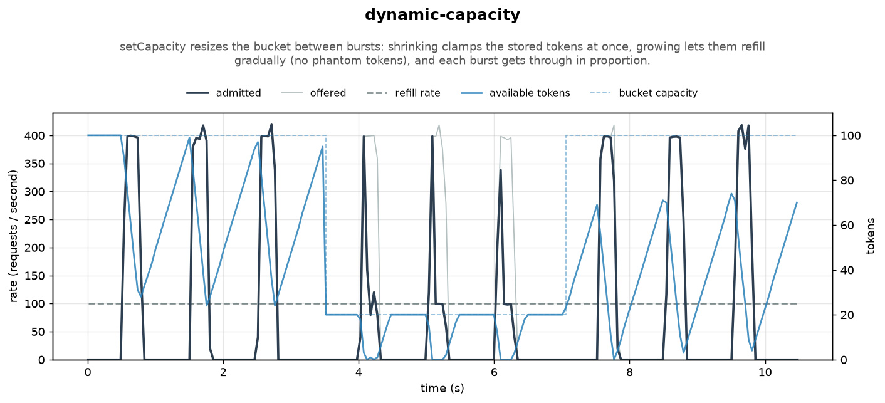

## Circuit breaker

An open-loop client offers a steady 500 rps through a `CircuitBreaker` to the `FlakyBackend`, whose error rate each
[scenario](src/main/scala/io/mienks/resilience/charts/circuitbreaker/Scenario.scala) scripts over time. The breaker
uses a 0.5 `failureRateThreshold`, 3 half-open calls, and exponential backoff from a 250ms `resetTimeout` up to a 2s
`maxResetTimeout`. The sliding window is passed in as a custom measurement strategy so the simulation can sample the
same windowed failure rate the breaker acts on.

Each chart plots, on the left axis, the **offered** rate and how it splits into calls that **succeeded**, **failed**,
or were **rejected** by the breaker without reaching the backend; on the right axis the backend's scripted **error
rate** (dashed), the breaker's **windowed failure rate**, and the **failure rate threshold** (dotted). Open periods are
shaded red and labeled with their reset timeout; the thin orange bands are half-open probes.

### outage-and-recovery
A full outage trips the breaker. Each failed half-open probe doubles the open time (exponential backoff, capped at
`maxResetTimeout`), so the recovered backend is only noticed at the next probe.

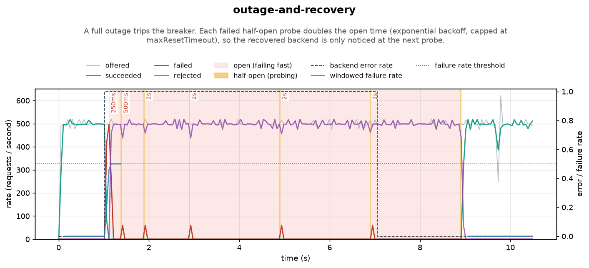

### failure-threshold
The backend error rate steps up. Below `failureRateThreshold` the breaker stays closed and lets the errors through;
once the windowed failure rate reaches it the breaker opens, until probes succeed again. A probe fails if any of its
3 calls does, so at the final 10% error rate a probe still fails about a quarter of the time.

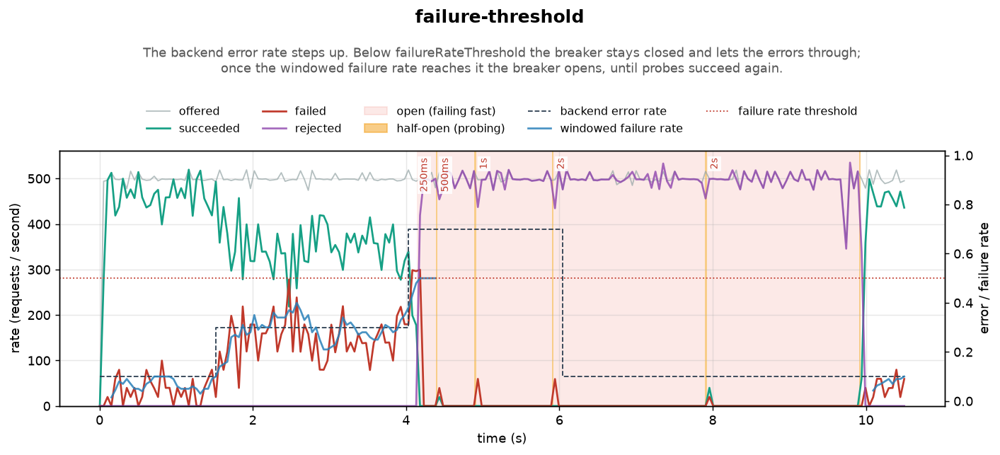

### transient-spikes-short-window
A count-based window of the last 100 calls (~0.2s of traffic) is short enough that every 150ms error spike trips the
breaker, rejecting healthy traffic until the next probe.

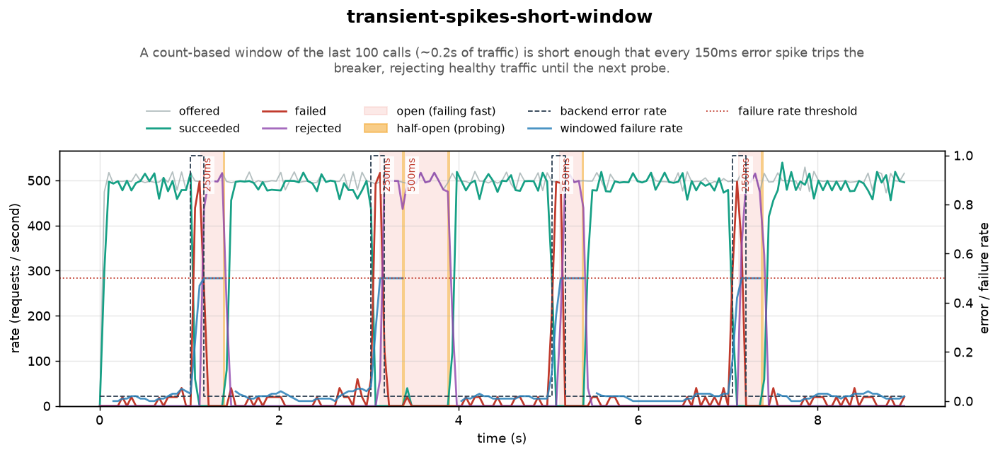

### transient-spikes-long-window
A 2s time-based window dilutes each 150ms error spike to under 10% failures, so the breaker rides the spikes out and
never opens.

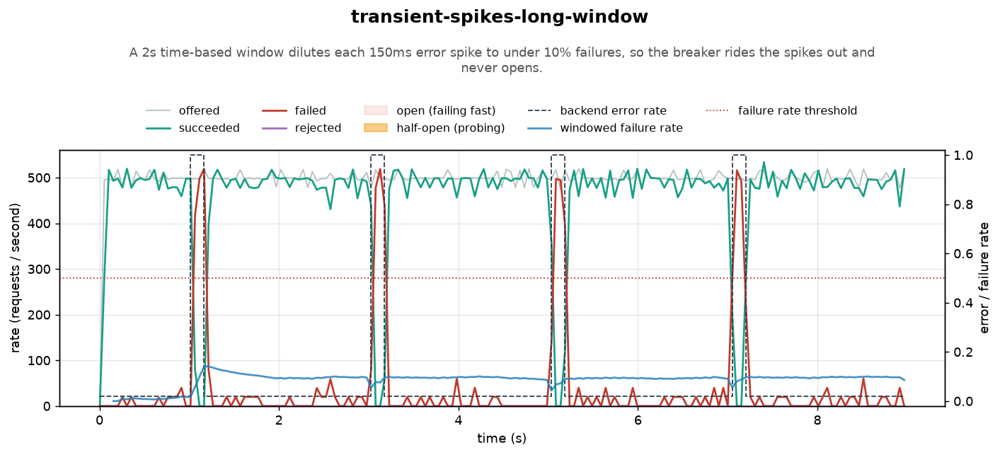
